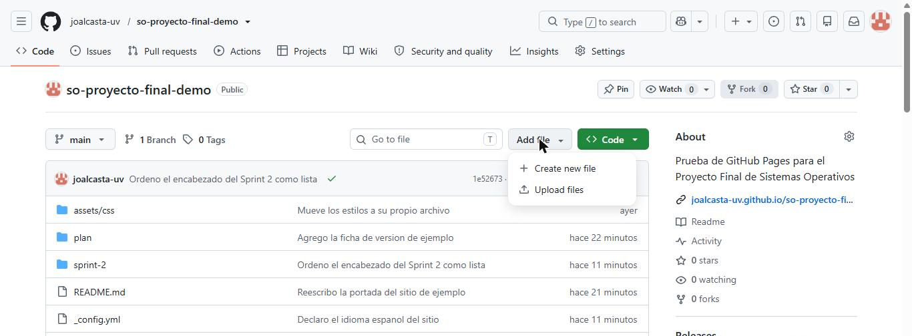
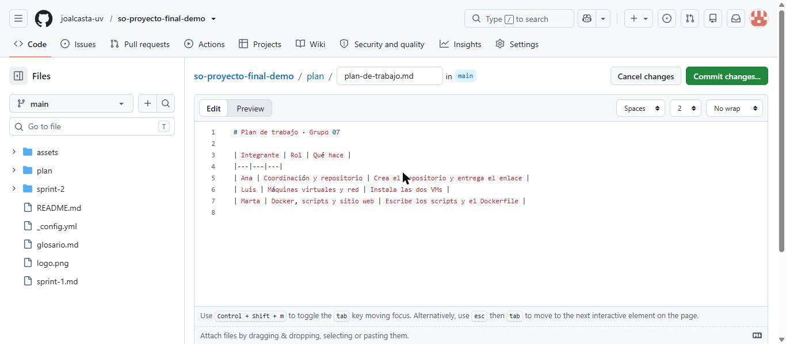
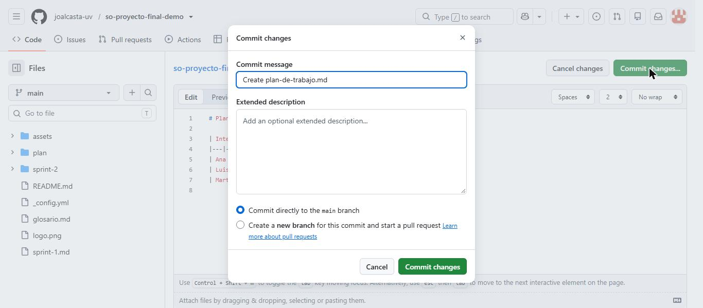
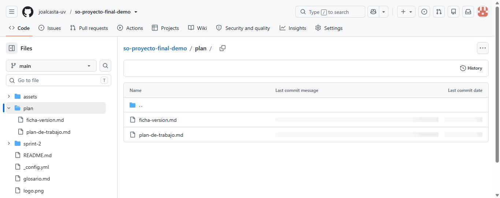
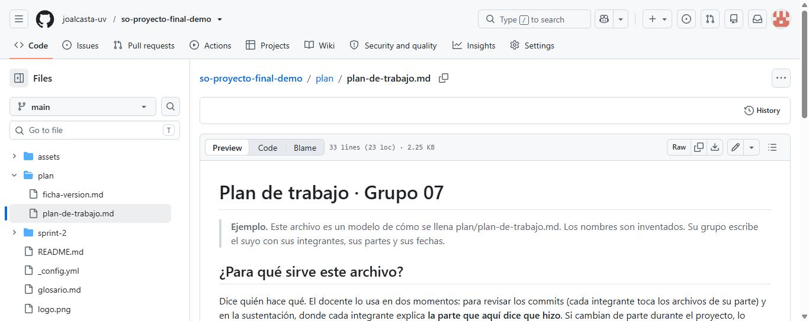

# Sprint 0 · Arranque, paso a paso

> **Página de ejemplo.** Explica cómo se hace el Sprint 0 desde cero, con capturas de GitHub. [Volver al inicio](./)

**Qué se entrega:** el enlace de un repositorio público de GitHub que tenga una carpeta `plan` con dos archivos: `plan-de-trabajo.md` y `ficha-version.md`.
**Dónde se entrega:** en el campus, solo el enlace. Sin video ni commits obligatorios.
**Cierre:** jueves 19 de noviembre en Santander y viernes 20 en Yumbo, 11:55 p. m.

Si no entiende alguna palabra, mírela en [Qué es cada cosa](glosario.md).

## Paso 1. Tener una cuenta y un repositorio público

1. Cree su cuenta en https://github.com/signup (si ya tiene una, úsela).
2. Pulse el botón **+** de arriba a la derecha y elija **New repository**.
3. Ponga un nombre sin espacios, por ejemplo `so-proyecto-g07`.
4. Marque **Public**. Si queda privado, el docente no puede abrirlo.
5. Pulse **Create repository**.

Todos los integrantes necesitan acceso para hacer commits: el dueño los agrega en **Settings → Collaborators**.

## Paso 2. Crear el primer archivo

En la página principal del repositorio pulse **Add file** y luego **Create new file**.

## Paso 3. Escribir el nombre y el contenido

En el campo del nombre escriba `plan/plan-de-trabajo.md`. Al escribir la barra `/` GitHub crea la carpeta `plan` solo. Abajo, en el cuadro grande, escriba el contenido en formato Markdown. El [ejemplo del plan de trabajo](plan/plan-de-trabajo.md) muestra qué debe llevar.

## Paso 4. Guardar el archivo (commit)

Pulse **Commit changes...**. En el mensaje escriba qué hizo, por ejemplo «agrego el plan de trabajo», y pulse **Commit changes**. Eso guarda el archivo en el repositorio.

## Paso 5. Repetir con la ficha de versión

Haga lo mismo con el archivo `plan/ficha-version.md`. Qué debe llevar está en el [ejemplo de la ficha](plan/ficha-version.md).

## Paso 6. Comprobar que quedó bien

Abra la carpeta `plan` del repositorio. Deben verse los dos archivos.

Abra cada archivo: GitHub lo muestra con formato, con títulos y tablas. Si ve símbolos como `|` y `#` sin formato, revise que el nombre termine en `.md`.

## Paso 7. Entregar el enlace

1. Copie la dirección de la página principal del repositorio. Se ve así: `https://github.com/usuario/so-proyecto-g07`
2. Ábrala en una ventana privada del navegador. Si se ve sin iniciar sesión, está público.
3. Péguela en la entrega del Sprint 0 en el campus. Un solo enlace por grupo.

## Lista de revisión

- [ ] El repositorio es público.
- [ ] Existe la carpeta `plan` con `plan-de-trabajo.md` y `ficha-version.md`.
- [ ] El plan de trabajo tiene a todos los integrantes, su rol y sus fechas.
- [ ] La ficha de versión tiene las seis respuestas de cada distribución, cada una con su enlace.
- [ ] El enlace del campus es el del repositorio.

## Dudas frecuentes

**No veo el botón Add file.** Está en la página principal del repositorio, a la izquierda del botón verde **Code**. Si no aparece, no ha iniciado sesión o no tiene permisos de escritura.

**GitHub me aparece en inglés o en español, y los nombres de los botones cambian.** Es el idioma de su cuenta o el traductor del navegador. Las capturas están en inglés; el traductor de Chrome puede cambiar nombres de carpetas como `assets`. Si pasa, desactive la traducción en esa página.

**¿Puedo editar después de entregar el enlace?** Sí. El docente revisa el repositorio como esté al cierre del sprint, por la fecha de los commits.
